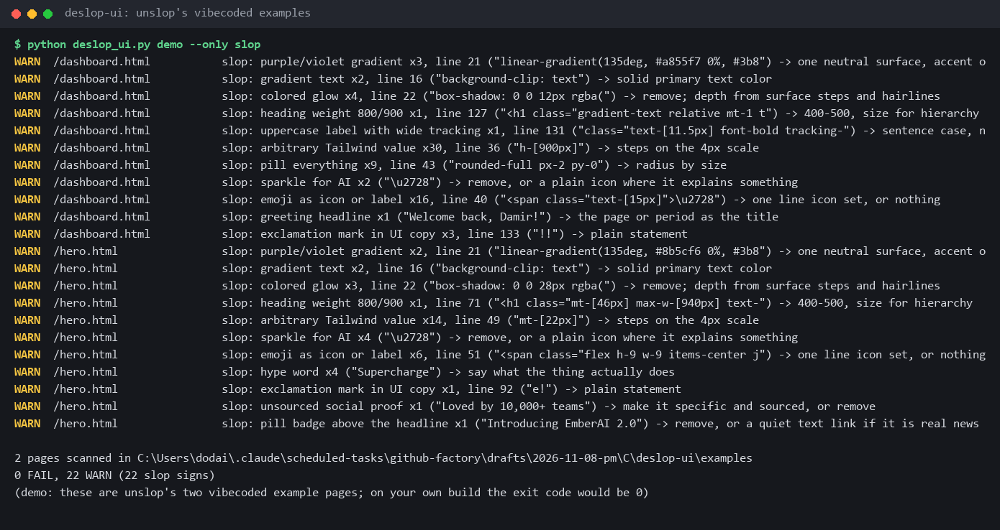
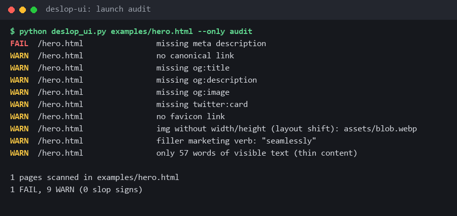

<div align="center">

# deslop-ui

**Find the AI look and the launch blockers in your built site, straight from disk: one Python file, no server.**

[unslop](https://github.com/heydamir/unslop) (11k stars) taught agents what vibecoded UI looks like. [juliobsz/skills](https://github.com/juliobsz/skills) audits a build before launch. This runs both as one check on your `dist/` folder, in seconds.

Works with **Claude Code** and **Codex**.

 



</div>

## Install in Claude Code / Codex

```bash
/plugin marketplace add Dodai0419/deslop-ui
/plugin install deslop-ui@deslop-ui
```

Codex: `git clone https://github.com/Dodai0419/deslop-ui && cp -r deslop-ui/skills/* ~/.codex/skills/`

## Quick start

```bash
git clone https://github.com/Dodai0419/deslop-ui && cd deslop-ui
python deslop_ui.py demo              # scans unslop's two vibecoded example pages
python deslop_ui.py path/to/dist      # your own build
```

Python 3.9+ and nothing else. The demo on unslop's dashboard example (excerpt, long lines shortened):

```text
WARN  /dashboard.html   slop: purple/violet gradient x3, line 21 ("linear-gradient(135deg, #a855f7 0%, #3b8") -> one neutral surface, accent only where it means something
WARN  /dashboard.html   slop: gradient text x2, line 16 ("background-clip: text") -> solid primary text color
WARN  /dashboard.html   slop: colored glow x4, line 22 ("box-shadow: 0 0 12px rgba(") -> remove; depth from surface steps and hairlines
WARN  /dashboard.html   slop: heading weight 800/900 x1, line 127 -> 400-500, size for hierarchy
WARN  /dashboard.html   slop: uppercase label with wide tracking x1, line 131 -> sentence case, normal tracking
WARN  /dashboard.html   slop: arbitrary Tailwind value x30, line 36 ("h-[900px]") -> steps on the 4px scale
WARN  /dashboard.html   slop: emoji as icon or label x16, line 40 -> one line icon set, or nothing
WARN  /dashboard.html   slop: greeting headline x1 ("Welcome back, Damir!") -> the page or period as the title
WARN  /dashboard.html   slop: exclamation mark in UI copy x3, line 133 ("!!") -> plain statement

2 pages scanned
3 FAIL, 39 WARN (22 slop signs)
```

Every slop line names the sign, how often it appears, the first line it is on, and the fix.

## Two passes

### 1. slop: the signs of a vibecoded UI

The signs from unslop's checklist that a pattern can see in HTML and CSS:

| Sign | What it matches | Fix |
|------|-----------------|-----|
| purple/violet gradient | `from-purple-500 to-blue-500`, `linear-gradient(... #8b5cf6 ...)` | one neutral surface, accent only where it means something |
| gradient text | `bg-clip-text`, `background-clip: text` | solid primary text color |
| colored glow | `shadow-[0_0_20px_rgba(...)]`, `box-shadow: 0 0 28px rgba(139,...)` | depth from surface steps and hairlines |
| blurred blob | `blur-3xl`, `filter: blur(80px)` | remove |
| heading weight 800/900 | `<h1 class="font-extrabold">`, `font-weight: 900` | 400-500, size for hierarchy |
| uppercase label, wide tracking | `uppercase tracking-widest`, `tracking-[0.1em]` on ALL CAPS text | sentence case |
| arbitrary Tailwind value | `mt-[13px]`, `h-[31px]` | steps on the 4px scale |
| pill everything | `rounded-full px-3 py-1` on every element | radius by size |
| sparkle for AI | the sparkle emoji in visible text | remove |
| emoji as icon or label | an emoji first inside a link, button, list item, heading or span | one line icon set, or nothing |
| greeting headline | "Welcome back, Damir!" | the page or period as the title |
| hype word | supercharge, seamless, unlock, magic, revolutionize, effortless, 10x | what the thing actually does |
| exclamation mark | `!!`, a label ending in `!` | plain statement |
| unsourced social proof | "Loved by 10,000+ teams" | specific and sourced, or remove |
| pill badge above the headline | "Introducing EmberAI 2.0" | remove, or a quiet text link |
| wordy placeholder | `placeholder="Search anything..."` | `Search` |
| fake-looking data | `$123,456`, `[X]` | plausible numbers |

The judgment signs (spacing rhythm, layout balance, too many accents) still need eyes. Pair this with the unslop skill for those.

### 2. audit: what blocks a launch



jury's `audit.mjs`, ported check for check, with the same levels and messages:

| Level | Checks |
|-------|--------|
| FAIL | no `lang`, no `<title>`, no meta description, no viewport, not exactly one `<h1>`, no `<main>`, `img` without `alt`, link or button with no accessible name, clickable `<div>`, placeholder text (lorem ipsum, TODO, Acme, John Doe, example.com), doubled heading text, no 404 page, `og:image` missing from the build |
| WARN | title over 70 chars, description outside 50-170, no canonical, missing Open Graph / Twitter tags, no favicon, skipped heading level, `img` without width, `target=_blank` without `noopener`, em/en dashes, AI-copy tells ("elevate", "seamless", "where design meets code", "not just X but Y"), repeated sentences, under 60 words, no robots.txt, no sitemap, images over 500 KB, ttf/otf fonts, JS over 300 KB gzipped, pages over 3 MB |

Exit code `1` if any FAIL, `2` if the path does not exist, else `0`, so it can gate CI:

```bash
npm run build && python deslop_ui.py dist
```

## The problem

- Agent-built UIs share one look: purple gradients, glows, emoji icons, "Supercharge your workflow". Visitors spot it in a second.
- unslop's checklist is prose for an agent to read. Nothing runs it, so the same signs come back on the next edit.
- jury's audit needs Node, starts a local server and crawls over HTTP, with a 40-page default cap. Another runtime to install in a Python or static-site project.

## The solution

| Idea | Fixes |
|------|-------|
| **The checklist as patterns** | 17 mechanical unslop signs become regex checks with a line number and a fix |
| **Audit from disk** | jury's page checks run on the files; site checks (404, robots, sitemap, og:image) look in the build folder; no server, no crawl, no page cap |
| **One file, stdlib only** | `deslop_ui.py` runs anywhere Python runs, in CI or from an agent |
| **Exit codes** | FAIL means do not ship; agents and CI read the code, not the prose |

## Use with Claude Code

```bash
/plugin marketplace add Dodai0419/deslop-ui
/plugin install deslop-ui@deslop-ui
```

Then ask: "deslop the landing page". The skill builds, runs `deslop_ui.py dist`, fixes each line, and runs it again until no FAIL is left.

## Use with Codex (ChatGPT)

```bash
git clone https://github.com/Dodai0419/deslop-ui && cp -r deslop-ui/skills/* ~/.codex/skills/
```

Or copy `AGENTS.md` into your project root.

## Options

```text
python deslop_ui.py <build-dir | file.html> [--only slop|audit] [--json]
python deslop_ui.py demo
```

## Benchmarks

| | jury `audit.mjs` + `serve.mjs` | deslop-ui audit pass |
|-|-|-|
| non-blank lines for the audit | 275 | 185 (lines 23-231 of `deslop_ui.py`) |
| runtime | Node 18+, a local HTTP server | Python 3 standard library |
| pages per run | crawled from the start page, 40 by default | every `.html` file in the folder |
| time, 200-page build | not measured (running the cloned upstream was blocked in this environment) | 2.25 s median of 5 runs, both passes |
| time, the 2-page demo | not measured | 0.57 s median of 3 runs, whole process |

Measured on Windows 11, Python 3.11, CPU busy with other work: `python deslop_ui.py <dir>` on a folder of 100 copies each of unslop's `hero.html` and `dashboard.html`. Line counts: `grep -cv '^\s*$'`. The whole file is 340 lines because it also holds the slop pass and the CLI.

The audit port is checked by `tests/test_deslop_ui.py`, one fixture per audit check with its level and message.

## Why this instead of unslop or jury

| | unslop | jury audit | deslop-ui |
|-|-|-|-|
| finds AI-look signs | the agent reads a checklist | AI-copy tells only | 17 signs, by line |
| redesigns the UI for you | yes, with direction and taste | no | no |
| launch audit | no | yes | yes, the same checks |
| needs | an agent | Node + a server | Python |

Use unslop to redesign. Use deslop-ui to check that the slop stays gone, on every build.

## FAQ

**Does a WARN mean my page is bad?**
No. A slop WARN is a question: keep the sign if it is your brand, with a reason. FAIL lines are the ones that block a launch.

**Does it read my React or Vue source?**
Not yet. Point it at the built HTML (`dist/`, `out/`, `build/`); Tailwind classes survive the build, so the slop pass still sees them.

**Does it change any file?**
No. It only reads, and writes nothing.

## Inspired by

- [heydamir/unslop](https://github.com/heydamir/unslop) (CC BY 4.0): the signs of slop and their fixes, and the two example pages in `examples/`.
- [juliobsz/skills](https://github.com/juliobsz/skills) (MIT): the jury launch audit, ported from `jury/scripts/audit.mjs`.

## Roadmap

- [ ] Scan JSX/TSX/Vue source as well as built HTML
- [ ] Contrast check on Tailwind color pairs
- [ ] `--fix` for the safe ones (trailing `!!`, uppercase labels)

## License

MIT for the code. The slop signs are adapted from unslop and the example pages are copied from it, under CC BY 4.0. See `LICENSE` and `NOTICE`.
